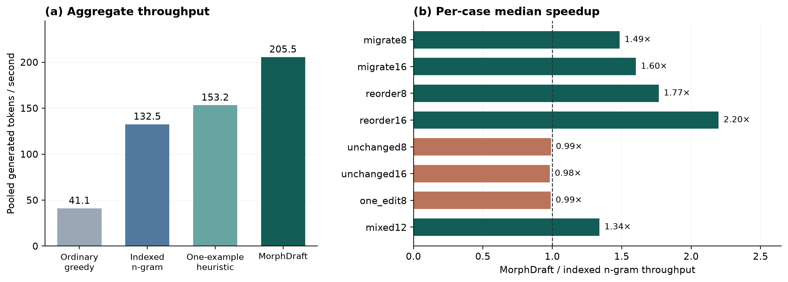

# MorphDraft

**Transformation-Aware Drafting for Speculative Decoding with CPU Learning and GPU Verification**

MorphDraft learns repeated code edits from a language model's already committed output. The CPU generalizes symbolic edit rules, rewrites known source code, and proposes continuations. The GPU target verifies every proposed token. There is no additional neural drafter or weight training.

[Read the paper PDF](paper/MorphDraft-paper.pdf) · [Paper source](paper/manuscript.md) · [Measured results](research/gpu_experiment/7b_measured/summary.json) · [Benchmark implementation](research/gpu_experiment/benchmark.py)

## Measured result

| Method | Pooled generated tokens/s | Decode or verification calls |
|---|---:|---:|
| Ordinary greedy | 41.05 | 9,015 |
| Indexed n-gram | 132.52 | 2,375 |
| One-example heuristic | 153.24 | 2,005 |
| MorphDraft | **205.55** | **1,475** |

MorphDraft delivers **55.1% higher pooled throughput than indexed n-gram** on eight constructed code-editing cases, with five timing repetitions and four methods: 160 measured requests. All outputs match ordinary greedy reference token IDs. The target model is Qwen2.5-Coder-7B-Instruct in BF16, on an NVIDIA A100 80GB PCIe GPU with an Intel Xeon Silver 4210R host CPU, batch size and concurrency one.



This is a restricted mechanism study, not a production vLLM benchmark. The one-example heuristic wins on simpler edits; unchanged and isolated-edit cases show small slowdowns. Token agreement preserves the target's mistakes: only five of eight cases satisfy the requested AST edits when constant-keyword ordering is ignored. There are no NVIDIA CPU measurements, stochastic-sampling results, or claims of established novelty.

## How it works

1. Align completed generated assignments with original assignments using unique preserved target identifiers.
2. Group examples by the original API and jointly generalize two source/output pairs, sharing holes across both patterns.
3. Validate rules against prior matching observations and remove conflicting rules.
4. Apply rules to the original source, tokenize the transformed text, and retrieve drafts with indexed n-gram lookup.
5. Verify drafts using the target's greedy choices and roll back unused KV states. Fall back to ordinary matching when needed.

The current implementation supports straight-line Python functions and normalizes formatting with Python ASTs. Rich program alignment remains future work. The method identifier `rules` is retained in code and saved records so the benchmark remains reproducible.

## Repository contents

- `paper/`: manuscript, PDF, figure, paper builder, and family-bootstrap analysis.
- `research/gpu_experiment/`: CPU proposers, GPU verifier, task generator, tests, audits, final measurements, and separately labeled smoke runs.
- `research/gpu_experiment/7b_measured/source_snapshot/`: **unchanged code that produced the measured results**, identified by protocol hashes.
- `research/edit_rule_proof.py`: shared-hole symbolic rule implementation.
- `research/`: earlier research pilots, including negative results and simple heuristic controls. These earlier studies are not pooled with the final GPU experiment.
- `scripts/`: pinned checkpoint downloader, family-bootstrap analysis, and artifact verification.
- `artifacts/`: original experiment archives. Model weights and downloaded tokenizers are excluded; model revisions are retained.

## Verify saved results without a GPU

From the repository root, with Python 3.11 or later:

```sh
python scripts/verify_artifacts.py
python research/gpu_experiment/test_proposers.py
python research/gpu_experiment/audit.py
python scripts/family_bootstrap.py
```

These checks validate existing results and CPU proposer behavior. They do not run new GPU timing experiments. Historical pilot scripts under `research/` retain their original host paths and are archival; the supported portable rerun entry point is the GPU benchmark below.

## Run a new GPU experiment

Create a separate Python environment and install a CUDA-compatible PyTorch build matching your system. The measured runtime used PyTorch 2.11.0+cu130 and Transformers 4.57.1. Install the remaining dependencies:

```sh
python -m pip install -r requirements.txt
python scripts/download_model.py --model 7b --output models/qwen-coder-7b
python research/gpu_experiment/benchmark.py --model 7b \
  --model-path models/qwen-coder-7b --repeats 5 \
  --output-dir runs/7b-new
```

The downloader fetches the pinned public model from Hugging Face. It can require substantial disk space. The benchmark itself loads only local files. Use `--smoke --repeats 1` for a four-case check, or `--model small` with a separately downloaded small checkpoint for development. The full paper result uses the 7B checkpoint, not the small model.

The portable runner differs from the frozen measured source only in environment/path handling, output-directory protection, input checks, and CPU identification. It refuses existing output directories so it cannot overwrite the saved measurements. The proposer and verifier algorithm are unchanged. Portable-run timing has **not** been remeasured for this publication package.

To analyze a new run:

```sh
python -c "import sys; from pathlib import Path; sys.path.insert(0,'research/gpu_experiment'); from analyze import analyze; analyze(Path('runs/7b-new'))"
python -c "import sys; from pathlib import Path; sys.path.insert(0,'research/gpu_experiment'); from audit import audit; audit(Path('runs/7b-new'))"
```

## Rebuild the paper

```sh
python -m pip install -r requirements-paper.txt
python paper/build_paper.py
```

The PDF builder uses DejaVu fonts from `/usr/share/fonts/truetype/dejavu` (on Debian/Ubuntu, install `fonts-dejavu-core`). Figures read the saved measured summary; they do not rerun inference.

## Provenance and third-party material

`ARTIFACT_MANIFEST.json` records package file hashes. The original protocol and source hashes are preserved within each measurement directory; original archive manifests describe the original snapshots, not the portable packaging changes. `PORTABILITY.md` explains the distinction.

The earlier HumanEval-derived pilot includes its upstream MIT license in `research/HUMANEVAL_LICENSE.txt` and dataset provenance in `research/dataset_source.json`. Model weights remain subject to the upstream model's license and are downloaded separately. This repository does not assign a new license to third-party material.
