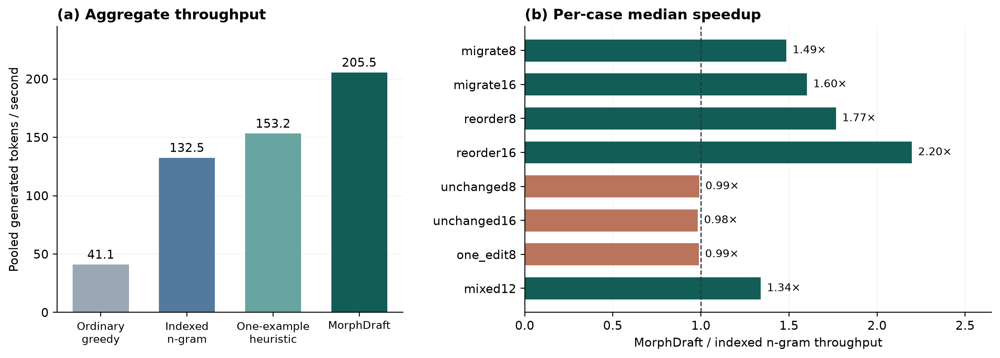

# MorphDraft: Transformation-Aware Drafting for Speculative Decoding with CPU Learning and GPU Verification

**Draft manuscript · November 24, 2026**  
Exploratory single-GPU study. Results describe a restricted prototype and constructed workloads.

## Abstract

Repeated code edits contain regularities that exact token matching cannot directly represent: an API can change names, acquire arguments, or reorder existing arguments across many statements. We investigate whether a CPU can infer these transformations from an ongoing generation and use them to propose longer continuations for a GPU language model. MorphDraft aligns completed output statements with input code, induces symbolic edit rules through joint anti-unification, and indexes a rewritten copy of the source. A target model verifies every proposed token. In a custom Transformers implementation using Qwen2.5-Coder-7B-Instruct on an NVIDIA A100, MorphDraft achieves 205.55 generated tokens/s, compared with 132.52 for indexed n-gram speculation and 153.24 for a one-example edit heuristic. These correspond to 55.1% and 34.1% higher pooled throughput across eight constructed cases and five timing repetitions. All 160 measured outputs match ordinary greedy decoding token for token. Gains concentrate on repeated transformations, especially argument reordering; unchanged and isolated-edit controls incur small slowdowns. This study supports online CPU rule induction as a promising drafting mechanism, while leaving real-repository evaluation, serving integration, broader novelty validation, and NVIDIA CPU measurements open.

## 1 Introduction

Speculative decoding reduces sequential target-model invocations by proposing several tokens and verifying them together. Retrieval-based approaches are attractive because they can reuse text without training or running another neural model. Code editing provides abundant reusable source text, but a repeated transformation can disrupt verbatim continuation at the same location in every statement.

Consider replacing an old call with a new API while swapping two arguments. An exact matcher can find repeated token fragments, but the original source does not contain the fully transformed continuation. Once the target has generated two examples, a symbolic learner can represent the shared edit and apply it to the remaining source statements. This creates text that becomes available for ordinary indexed retrieval before the target has generated it.

MorphDraft explores this opportunity using the CPU as an online proposer and the GPU as the authoritative verifier. The CPU does not run the large language model or train a student. It constructs candidate text from input code and the target's already committed output. Incorrect predictions cost time rather than bypassing verification.

The contribution is an exploratory combination of online symbolic edit induction, rewritten-source retrieval, and standard target verification. We provide a restricted implementation, a controlled comparison against indexed n-gram lookup and a stronger edit heuristic, and an audit of output agreement and failure cases. Neither anti-unification nor speculative verification is new. The experiments do not establish state-of-the-art performance or priority over all related code-editing systems.

## 2 Related Work

**Speculative verification.** Leviathan, Kalman, and Matias introduce speculative decoding with a target model checking a faster drafter [1]. MorphDraft changes the proposer; its verification argument follows the standard greedy special case. The present implementation does not implement exact stochastic speculative sampling.

**Retrieval and reuse.** CopySpec copies continuations from repeated text [2]. SAM Decoding uses suffix automata for efficient matching [3]. Cacheback develops cache-based speculative reuse [4], while AdaPLD combines adaptive retrieval with richer reuse mechanisms [8]. These studies make clear that indexed matching and training-free text reuse are established ideas. We compare against a local hash-indexed n-gram implementation, not against released implementations of all these systems.

**Code editing and transformation learning.** EfficientEdit studies edit-oriented speculative decoding for code editing [5]. EditLord learns code-transformation rules to improve editing models [6]. Getafix learns generalized code-fix patterns and illustrates the established role of anti-unification in program transformation [7]. MorphDraft's candidate distinction is its use of rules induced during the current target generation to construct speculative text on the CPU. An exhaustive novelty assessment and direct experimental comparisons remain necessary.

## 3 Method

### 3.1 Setting and information boundary

Each request supplies an editing instruction, an original Python function, and an assistant prefix containing a Python code fence and function header. The prototype operates on straight-line assignments with unique preserved targets such as `result_0` and `result_1`. These identifiers provide alignment keys between original and generated statements. This is a deliberately constrained setting; robust alignment for arbitrary programs is not implemented.

At a decoding step, the proposer can inspect the original input and the already committed target output. It cannot access future target tokens or a reference solution. Each request starts with an empty rule set. There is no rule transfer between requests.

### 3.2 Observing and generalizing edits

The CPU parses only the newline-terminated portion of the generated prefix, ignoring an incomplete trailing statement. It pairs completed assignments with source assignments sharing the same target identifier and groups pairs by the original call expression's callee. For each call family, the latest two pairs provide candidate examples of a transformation.

Joint anti-unification generalizes the before and after syntax trees together. Disagreements become shared holes: the same pair of differing subtrees receives the same placeholder wherever it occurs across the source and target patterns. This preserves relationships between copied values and arguments, rather than treating each changed position independently. A schematic inferred rule is:

```text
old_send(A, B, retries=1)
    => client.send(B, A, retries=1, secure=True)
```

Here `A` and `B` denote matched subtrees, not literal variable names. Applying the rule substitutes the current statement's arguments into the new positions. The rule can therefore represent an argument permutation that the heuristic control cannot express.

We represent a rule as a source pattern and replacement pattern, with the constraint that every replacement hole must be bound by the source match:

```math
r=(\ell\Rightarrow u),\quad \ell\sigma=s,\quad \widehat{t}=u\sigma,\quad \mathrm{Vars}(u)\subseteq\mathrm{Vars}(\ell).
```

The candidate must reproduce all previously observed completed edits to which its source pattern applies within the family. Conflicting evidence removes an active rule. Consistency with a small observed prefix does not prove that the rule will hold later; verification remains essential.

### 3.3 Turning rules into token drafts

Active rules rewrite a copy of the original source syntax tree. The CPU unparses and tokenizes the result, rebuilding the rewritten-text index only when that text changes. AST unparsing normalizes formatting; the prototype does not preserve arbitrary concrete syntax.

The proposer queries this index using the suffix of the full prompt plus committed output. It tries exact n-gram lengths from eight down to two, chooses the earliest occurrence among ties, and returns up to eight following tokens. If the rewritten index supplies no continuation, it falls back to ordinary indexed n-gram retrieval. The ordinary baseline has access to the same prompt and committed text.

```text
Initialize ordinary index and an empty per-request rule set.
Until EOS or the output limit:
    Parse complete committed statements; align with source.
    Generalize and validate candidate rules within each family.
    Rewrite source and refresh its index if the text changed.
    Retrieve a draft; fall back to ordinary n-gram lookup.
    Verify with target; commit matching prefix and correction/bonus.
    Discard uncommitted draft KV states; update ordinary index.
```

### 3.4 Target verification and conditional agreement

The GPU verifies a proposed continuation in a causal forward pass. The implementation accepts the longest draft prefix agreeing with the target's greedy choices, then commits the target correction or bonus token when applicable. It discards cache states beyond the committed prefix and respects EOS and the output limit.

**Conditional proposition.** If ordinary and speculative execution use the same target next-token function, logit processing, tie breaking, termination rules, and correct cache rollback, verified greedy speculation produces the same output as ordinary greedy decoding for any proposer.

**Argument.** Assume the committed prefixes agree. Every accepted draft token equals the target's greedy token at its corresponding agreed prefix. At the first disagreement, only the target correction is committed; later verification positions are discarded. A bonus token likewise comes from the target after an entirely accepted draft. Induction establishes agreement until termination. This is standard verification reasoning, not a new correctness theorem. Different numerical execution paths can affect actual logits, making empirical token-level checks necessary.

### 3.5 Cost and implementation limits

A useful local profitability condition is:

```math
C_{\mathrm{CPU}}+C_{\mathrm{verify}}(k)<(1+\mathbb{E}[a])C_{\mathrm{decode}},
```

where `a` is the number of accepted draft tokens and CPU cost includes amortized induction and indexing. This model explains the tradeoff; it is not a measured law. End-to-end request measurements additionally include setup and prefill.

The current CPU implementation reparses a growing prefix and can rewrite the whole source. It has neither constant-time updates nor an enforced memory or CPU budget. A bounded n-gram query window does not make the entire proposer constant-cost. Longer contexts and many concurrent requests could change the cost balance substantially.

## 4 Experimental Setup

### 4.1 Model and hardware

We evaluate Qwen/Qwen2.5-Coder-7B-Instruct, with 7,615,616,512 parameters, in BF16 on one NVIDIA A100 80GB PCIe GPU. The host CPU is an Intel Xeon Silver 4210R, with one PyTorch CPU thread. The runtime uses PyTorch 2.11.0+cu130, Transformers 4.57.1, and scaled dot-product attention. Batch size and concurrency are both one.

This is a custom Transformers decoding loop. It does not use vLLM, tensor parallelism, torch.compile, or CUDA-graph serving optimizations. Results measure request generation throughput in this implementation, not production serving capacity. No NVIDIA CPU was measured.

### 4.2 Workloads and controls

Eight constructed cases cover five families: repeated API migration at eight and sixteen calls; argument reordering at eight and sixteen calls; unchanged source at eight and sixteen calls; one isolated edit among eight calls; and a mixed twelve-call example with two APIs. Unique assignment identifiers and a supplied assistant header simplify parsing and alignment. The maximum generation length is 512 tokens; no measured request reaches the limit.

We compare four methods sharing the target model and verification machinery: ordinary greedy decoding; hash-indexed n-gram speculation; a one-example edit heuristic; and MorphDraft. All speculative methods use draft length at most eight. The n-gram range is two through eight.

The heuristic is a substantive control: after one completed example, it copies the changed callee and the complete literal keyword-argument list when positional arguments remain unchanged. It supports keyword insertion, deletion, and replacement. It cannot learn positional argument reordering. It uses the same rewritten-source retrieval and ordinary fallback as MorphDraft. Because both expressiveness and observation count differ, this comparison is not a clean one-versus-two-example ablation.

### 4.3 Measurement and audit

We run five timing repetitions per case and method, totaling 160 requests, with randomized order and seed 42. Separate untimed ordinary-decoding outputs provide references. Model loading and warmup are excluded; initial tokenization, index construction, prefill, CPU proposals and learning, GPU verification, synchronization, and KV rollback are included. The supplied assistant header is excluded from generated-token counts; EOS is included.

Pooled throughput is total generated tokens divided by total request wall time. It is not the arithmetic average of per-case throughput. Each method generates 9,015 tokens across forty measured requests. Per-case tables report medians over five repetitions. Timing repetitions do not create new independent tasks. A preceding small smoke experiment informed the stronger heuristic; these cases are not a held-out benchmark.

## 5 Results

### 5.1 Aggregate throughput

| Method | Generated tokens/s | Total request time s | Decode or verify calls |
|---|---:|---:|---:|
| Ordinary greedy | 41.05 | 219.59 | 9,015 |
| Indexed n-gram | 132.52 | 68.03 | 2,375 |
| One-example heuristic | 153.24 | 58.83 | 2,005 |
| MorphDraft | **205.55** | **43.86** | **1,475** |

**Table 1.** Pooled results over forty requests per method. Call counts exclude prefill. Every method produces the same 9,015 output tokens across its requests.

MorphDraft improves pooled throughput by 55.1% over indexed n-gram lookup, by 34.1% over the heuristic, and by approximately 5.01 times over ordinary decoding. Relative to indexed n-gram lookup, it reduces decode/verification calls by 37.9%. These are workload-level ratios, not uniform per-task gains.



**Figure 1.** Left: pooled throughput across all cases and repetitions. Right: MorphDraft throughput divided by indexed n-gram throughput using each case's median request performance. The dashed line denotes equal throughput. The controls expose overhead when reusable transformations are absent.

### 5.2 Where the improvement comes from

| Case | Output tokens | N-gram tokens/s | Heuristic tokens/s | MorphDraft tokens/s |
|---|---:|---:|---:|---:|
| migrate8 | 138 | 130.73 | 199.81 | 194.14 |
| migrate16 | 286 | 128.60 | 210.38 | 206.08 |
| reorder8 | 194 | 98.42 | 97.63 | 173.91 |
| reorder16 | 404 | 97.05 | 96.15 | 213.32 |
| unchanged8 | 130 | 271.32 | 269.07 | 268.76 |
| unchanged16 | 270 | 286.34 | 284.46 | 281.45 |
| one_edit8 | 135 | 214.78 | 211.46 | 212.42 |
| mixed12 | 246 | 116.81 | 172.01 | 156.54 |

**Table 2.** Median per-case throughput over five repetitions. Output lengths include EOS and exclude the supplied header.

The largest gain occurs on reorder16: approximately 2.20 times indexed n-gram throughput. Rules represent the argument permutation, whereas the heuristic retains the original positional arguments. On the simpler migration cases and mixed12, the heuristic is faster than MorphDraft. It can start from one observation and does not need the richer generalization machinery.

Unchanged and isolated-edit controls show approximately 0.9–1.7% lower throughput than indexed n-gram lookup. They require the same number of target calls under MorphDraft and indexed n-gram retrieval, leaving CPU work as overhead. This evidence supports selective activation as future work; the current prototype does not implement a learned activation policy.

The first rules appear after 38 generated tokens on migration cases, 52 on reordering cases, and 62 on mixed12. No rule activates on the unchanged or isolated-edit controls. Startup observations limit benefit on short outputs.

### 5.3 CPU overhead and verification savings

Across forty requests, MorphDraft spends 1.306 seconds in proposal and learning work, compared with 0.056 seconds for indexed n-gram lookup: approximately 32.66 versus 1.40 milliseconds per request. Verification wall time falls from 66.02 to 40.88 seconds. The additional approximately 1.25 seconds of proposal work accompanies approximately 25.14 seconds less verification time.

MorphDraft accepts 7,580 of 10,565 proposed tokens, versus 6,680 of 17,800 for indexed n-gram lookup: approximately 71.7% versus 37.5%. Total generated tokens per decode/verification call rise from 3.80 to 6.11. Accepted-token counts include EOS; they need not equal total output tokens minus call counts. These component measurements are wall-clock timings, not isolated GPU kernel profiles.

### 5.4 Agreement is not editing accuracy

All 160 measured outputs match their ordinary-decoding reference token IDs exactly. An audit also checks thirty-two first-repetition traces containing 2,974 verification steps, record consistency, throughput arithmetic, and source snapshot hashes. Two independent Hugging Face `model.generate` checks, on migrate8 and migrate16, match the custom ordinary loop. Six CPU proposer tests pass.

The underlying target nevertheless makes editing mistakes. All eight outputs parse, but only five match the requested AST when ordering of constant keyword arguments is ignored. Both migration cases drop the pre-existing `retries=1` argument. The mixed case drops `retries` and adds both `timeout=10` and `durable=True` to both API families. Strict AST comparison accepts four cases because one otherwise conforming case orders keywords differently.

All failures remain in the primary timing results. MorphDraft preserves target behavior, including errors; it does not improve editing accuracy or establish semantic program correctness. No generated code is executed. A post hoc diagnostic restricted to the five structurally conforming cases gives 138.05 versus 221.97 tokens/s for indexed n-gram and MorphDraft, respectively; this subset is neither the primary benchmark nor a functional correctness evaluation.

### 5.5 Sensitivity to workload composition

The primary 1.551-times speedup is computed from pooled measured time. To examine workload sensitivity separately, we calculate a paired ratio from each case's median request time and resample the five task families, keeping each family's member cases together. With 20,000 resamples and seed 261124, the descriptive 95% percentile interval is 1.084–1.881 around a 1.549-times point estimate versus indexed n-gram lookup. Against the heuristic, the corresponding estimate is 1.340 with interval 0.941–1.807.

These intervals describe sensitivity within five constructed families. They are not evidence of generalization to real repositories or a well-powered population-level significance test. The heuristic comparison includes ratios below one, consistent with its case-level wins. Repeating timings reduces measurement noise but does not resolve the limited diversity of tasks.

## 6 Discussion and Limitations

The experiment demonstrates a useful CPU role: constructing target-verifiable continuations from structural regularities. The CPU need not reproduce neural inference to reduce the GPU's sequential work. In this setting, its value comes from transforming known text into a better retrieval source.

The evidence is narrow. We evaluate one approximately 7.62-billion-parameter model, one GPU, one host CPU, greedy generation, batch size one, and short constructed Python functions with convenient alignment keys. We do not test real repository edits, multiple programming languages, stochastic sampling, energy, concurrent serving, or competing production inference engines. An optimized n-gram or suffix implementation inside a serving engine could change both the baseline and overhead balance.

The prototype does not support general scoped bindings, robust matching under renamed assignment targets, arbitrary incomplete-program parsing, or formatting-preserving rewriting. Whole-prefix parsing and whole-source rebuilding may become expensive at scale. Rule consistency only checks observed matching examples; it does not certify future transformations. A rule can follow a target-model error and still be an effective predictor.

The stronger heuristic is an essential limitation on the claim: simple edits often require only a simple rule. A practical system should select the cheapest useful proposer. Establishing that decision mechanism, and separating shared-hole induction from rewriting and indexing through controlled ablations, remains future work.

For a submission, the highest priorities are real-code tasks with held-out edit families, direct comparisons with current retrieval and edit-oriented speculative systems, multiple target models, context-length and concurrency scaling, CPU profiling, and end-to-end serving integration. A Grace or other NVIDIA CPU study would require matched software settings and direct hardware measurements; no such performance claim follows from this Intel-host experiment.

## 7 Conclusion

MorphDraft uses online CPU symbolic learning to turn repeated edits into speculative continuations for GPU verification. On a restricted eight-case experiment, it increases pooled throughput from 132.52 to 205.55 tokens/s over indexed n-gram lookup while preserving every tested greedy output. Argument reordering provides the clearest benefit; simpler edits favor a cheaper heuristic, and non-repetitive controls expose overhead. The result motivates a broader study of transformation-aware drafting, with novelty and deployment value still to be established beyond this prototype.

## References

[1] Leviathan, Y., Kalman, M., and Matias, Y. **Fast Inference from Transformers via Speculative Decoding.** ICML, 2023. https://arxiv.org/abs/2211.17192

[2] **CopySpec: Accelerating LLMs with Speculative Copy-and-Paste.** 2025. https://arxiv.org/abs/2502.08923

[3] Hu, Y., et al. **SAM Decoding: Speculative Decoding via Suffix Automaton.** ACL, 2025. https://aclanthology.org/2025.acl-long.595/

[4] Ma, Z., Gim, I., and Zhong, L. **Cacheback: Speculative Decoding With Nothing But Cache.** 2025. https://arxiv.org/abs/2511.21699

[5] Wang, P., et al. **EfficientEdit: Accelerating Code Editing via Edit-Oriented Speculative Decoding.** 2025. https://arxiv.org/abs/2506.02780

[6] Li, W., et al. **EditLord: Learning Code Transformation Rules for Code Editing.** ICML, 2025. https://proceedings.mlr.press/v267/li25al.html

[7] Bader, J., Scott, A., Pradel, M., and Chandra, S. **Getafix: Learning to Fix Bugs Automatically.** 2019. https://arxiv.org/abs/1902.06111

[8] Liu, R., et al. **AdaPLD: Adaptive Retrieval and Reuse for Efficient Model-Free Speculative Decoding.** 2026. https://arxiv.org/abs/2606.05742

## Appendix A Reproducibility and Artifact Scope

The measured model revision is `c03e6d358207e414f1eca0bb1891e29f1db0e242`. The NVIDIA driver version is 580.159.03. The experiment archive contains the protocol, raw request records, summaries, reference outputs, audit, checks, and source snapshots; model weights are excluded. The manuscript adds a descriptive family-bootstrap analysis without running new GPU experiments.

Primary records reside under `binding-aware-speculation/gpu_experiment/7b_measured/`: `protocol.json`, `results.json`, `summary.json`, `audit.json`, and `independent_checks.json`. Frozen measured source is under `source_snapshot/`. The standalone experiment package is `gpu-edit-rule-throughput-results.zip`; the paper package includes this manuscript, figure, analysis, and PDF.

The measured protocol records SHA-256 source hashes:

```text
benchmark.py
ba858b32a301be59636ad667fb207e3f2b7aeb370e2c3ab23ccb28dac75d7394
proposers.py
e479b7c9af139454a1d1ad0ed0d8f8b12f24ff9b47f9d1fdac390090fb42c015
tasks.py
919d8a4af191af24a56708ba9062954add847e78541bc3dd92b263eae10493a3
```

| Evidence established here | Evidence still required |
|---|---|
| Eight constructed cases; five timing repetitions | Held-out real-repository edit benchmark |
| One BF16 target on A100; Intel CPU proposer | Multiple targets and NVIDIA CPU measurements |
| Token agreement for all measured greedy outputs | Stochastic implementation and distributional validation |
| Comparison with indexed n-gram and strong heuristic | Modern serving baselines and component ablations |
| CPU and verification wall-time components | Long-context, concurrency, memory, and energy studies |

